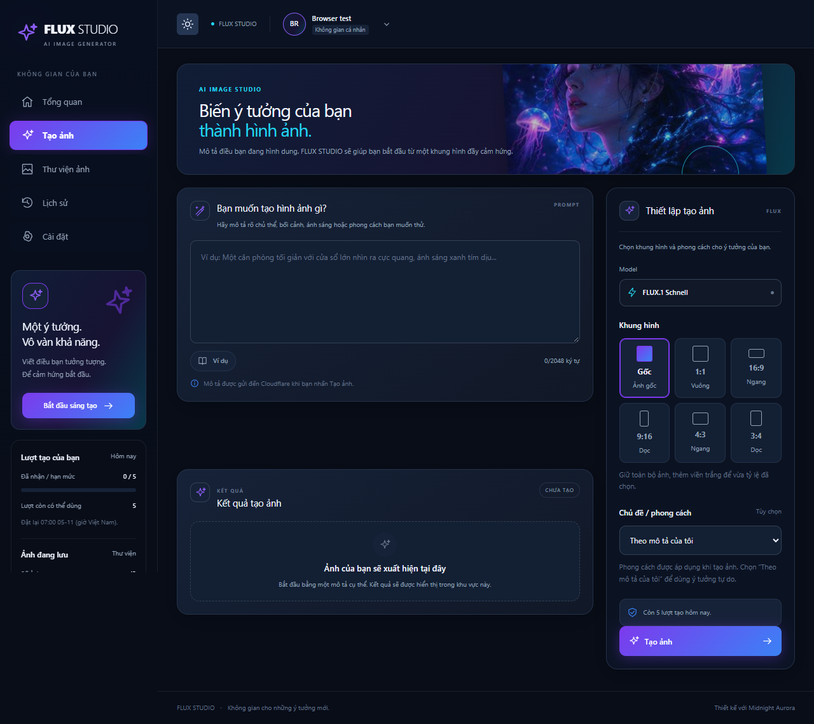
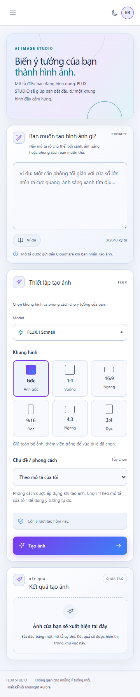

# Create controls — 04/11/2026

## CONFIRMED — source and scope

The owner requested a reference-inspired panel with light/dark mode, aspect ratio
and theme/style, excluding image-count selection. The owner then explicitly
selected keeping the entire image and adding borders rather than cropping.
This request authorizes the scoped light-palette/style/ratio exception to earlier
dark-only and deferred-control rules; `writing-block.md` remains unchanged.
Related sources read: Issue#1, PRD, shared API contract, BACKEND_RULES,
IMPLEMENTED_UI_REFERENCE, color/motion/accessibility/responsive/image rules and
frontend-design/api-integration/backend-api/backend-testing workflows.

## Result

- Topbar sun/moon control switches the shared token layer, defaults to dark and
  saves `flux.theme` locally; blocked storage does not prevent in-session changes.
- Create panel keeps a fixed FLUX model, adds original/1:1/16:9/9:16/4:3/3:4 radio
  cards and a native style selector: prompt-only/watercolor/cinematic/photographic/
  illustration/anime. No quantity, Advanced or model-switch control was added.
- API validates enums and stores options in existing job settings. Style guidance
  is server-owned and only changes submittedPrompt; the original stays exact.
  Combined submitted text is limited to2048 before quota reservation.
- Non-default options participate in the idempotency fingerprint; legacy/default
  raw fingerprints remain compatible. Browser pending requests preserve the full
  payload, and selectors lock while unresolved or active. Job polling/reload
  restores the saved options without another create request.
- Ratio means a centered white padded canvas, not a native FLUX dimension request.
  Original pixels are neither cropped nor enlarged. Padding uses the durable raw
  checkpoint and PNG output; saved metadata/hash refer to final file bytes.
  Existing4096px/10MiB caps remain; auto leaves original bytes intact.

The current [Cloudflare FLUX schema](https://developers.cloudflare.com/workers-ai/models/flux-1-schnell/)
documents prompt and steps rather than aspect dimensions. No unsupported
width/height parameter, cloud service, dependency or migration was added.

## Verification

- FE and BE builds passed.
- Unit:43 pass/1 skip (dedicated MongoDB test URI absent). Padding tests compare
  every original RGB pixel for all ratios and inspect white borders/exact ratios.
- Isolated integration:15 pass/0 skip. Added option replay/conflict cases,
  invalid-enum/count rejection, original prompt retention and padded saving retry:
  two saving attempts, one inference and one quota reservation.
  Final replay review also compares stored original/options directly, rejecting
  a literal prompt equal to another intent's serialized hash input. Backend build,
  unit43 pass/1 skip and the affected product integration were rerun after this
  guard; all passed.
- Browser: actual API + temporary replica set + synthetic image/storage stub;
  no cloud transport or running worker. Both themes inspected at360/768/1280/1536,
  no horizontal overflow, theme persisted after reload, native radio arrow-key
  interaction, style/ratio reached persisted job settings, controls locked while
  active and reloaded selection matched job. Existing library/ownership/history
  browser regression passed; console errors0. Only one explicit CTA POST was sent,
  with providerCalls0; terminal result in this test is a labelled synthetic fixture.
- Local screenshots/report are ignored artifacts in
  `backend/data/library-history-browser/`, named `create-controls-{light|dark}-{width}.png`.
- Integration initially hit MongoDB OutOfDiskSpace on nearly-full C during parallel
  temporary servers. Retried with a task-owned temporary directory on F and
  `node --import tsx --test --test-concurrency=1 tests/integration/*.test.ts`; all passed.
  No shared data was deleted or modified to resolve this.
- Local Docker backend restarted only after verifying zero active jobs.

## Limits

No live cloud image was generated for verification. Style is textual guidance,
not a100% fidelity guarantee. Aspect ratios may add visible whitespace and explicit
ratios produce PNG; images that would exceed existing size caps are rejected via
the existing saving failure/recovery path. Light mode was visually checked on the
create screen and shared shell, not exhaustively on every historical screen.
No GitHub acceptance checklist is marked complete by this work. This report
records verification before the requested commit/push/PR/merge handoff.

## UI evidence

These screenshots were captured by the isolated browser test described above.
Account/usage data are temporary fixtures, not production records or cloud output.

