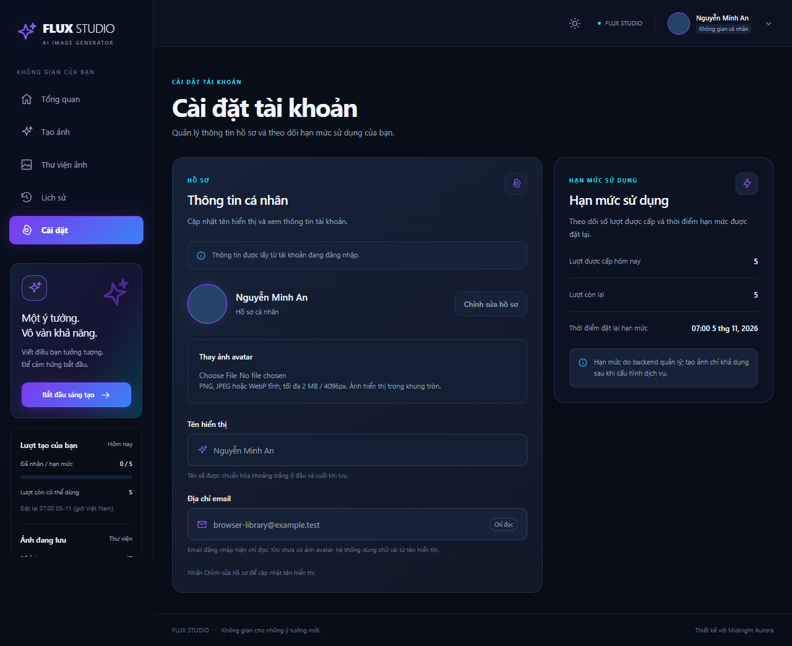
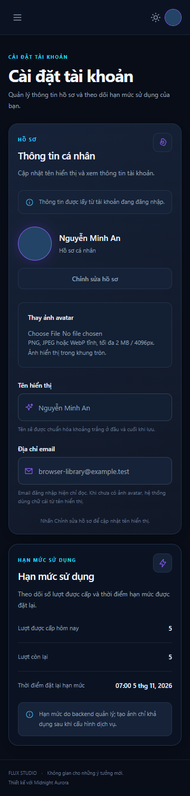

# Profile and shared account alignment — 04/11/2026

## CONFIRMED scope and baseline

The owner requested updating from develop before implementation, a consistently
right-aligned account cluster on all authenticated pages, and profile editing.
After clarification, the owner selected **avatar upload only** as the expansion;
email stays read-only. Existing display-name editing is completed rather than
replaced by a second API. No email/password-change workflow was added.

Fetched origin and fast-forwarded local develop to `fad955c` (PR#30), then created
`codex/profile-and-account-alignment`. The starting tree was clean. The upstream
Vietnamese translation default change remains intact.

Sources: writing-block.md (read in full), PRD, shared API contract, backend/API/DB
rules, implemented UI reference, motion/accessibility guidance and frontend-design,
api-integration, backend-api, mongodb-mongoose and backend-testing workflows.

## Implementation

- Shared topbar uses automatic start margin for its right group, independent of
  search visibility. Long names truncate with the full value available in title;
  mobile retains avatar/menu without horizontal overflow.
- Settings offers Edit/Save/Cancel for display name, loading/error/reload states,
  validation and immediate header refresh after confirmed successful save.
- Shared avatar component displays the private image or consistent first/last-name
  initials on absence/read error. Picking a file only creates a local preview;
  explicit Save uploads, Cancel clears selection and object URLs are revoked.
- PUT/GET users/me/avatar use existing session/Origin/CSRF and Cloudinary registry.
  Images are validated from bytes (static PNG/JPEG/WebP,2MiB/4096px), oriented,
  stripped of metadata and resized within256x256 as WebP. Server-generated paths
  are owner-scoped, not client IDs/URLs. Delivery is authenticated private/no-store.
- users stores nullable avatar metadata and a pending-deletion array. Revision CAS
  rejects simultaneous conflicting replacements; a lost DB acknowledgement is
  reconciled before considering deletion. Old images are queued atomically and
  cleanup retries at later uploads. Existing library counts and AI quota are not
  touched. Five collections and existing indexes remain; no migration/dependency.

## Verification

- FE/BE build passed.
- Full unit suite:44 pass/1 skip (MONGODB_TEST_URI not configured); no cloud calls.
- Full isolated integration:16 pass/0 skip, including avatar validation, MIME
  mismatch,2MiB overflow, session/CSRF, ownership, private headers, storage failure,
  pending cleanup, concurrent replacements and DB commit with lost acknowledgement.
- Browser uses actual API + temporary MongoDB and stub storage, no cloud calls:
  six authenticated routes at360/768/1280/1536 in both themes (48 route/size/theme
  checks), account group right edge matches header padding; no horizontal overflow.
  Name validation/Cancel/trim/Save/header initials/reload and avatar invalid-file/
  preview-without-upload/Save/header image/reload passed. Existing library/history,
  auth, create controls and ownership regressions passed; console errors0.
- Provider/storage boundary unit tests verify avatar paths cannot target another
  owner and uploads remain authenticated. MongoDB tests use task-owned temporary
  files on F and run sequentially to avoid the nearly-full C drive.
- Local screenshots: backend/data/library-history-browser/profile-settings-1280.png
  and profile-settings-360.png. These contain synthetic test account/avatar data,
  not real cloud output. No cloud request was made by tests.
- Local backend restarted after verifying zero active generation jobs; health200.

## Remaining boundaries

Live Cloudinary upload was not executed by the agent. Users explicitly saving an
avatar will use their configured storage service. Cleanup has no new background
worker: pending old avatars retry on a subsequent upload, with bounded attempts
per request and a backlog cap. An uncertain cloud/DB result may retain a private
object requiring later reconciliation; active images are not deleted blindly.
Upload rate limiting is per backend process (10 attempts/user/15min).

No change to image-generation configuration, theme tokens, billing or email policy.
This report records verification before the owner's requested PR/merge handoff.

## UI evidence

Synthetic test account and avatar; these screenshots are not live cloud results.

