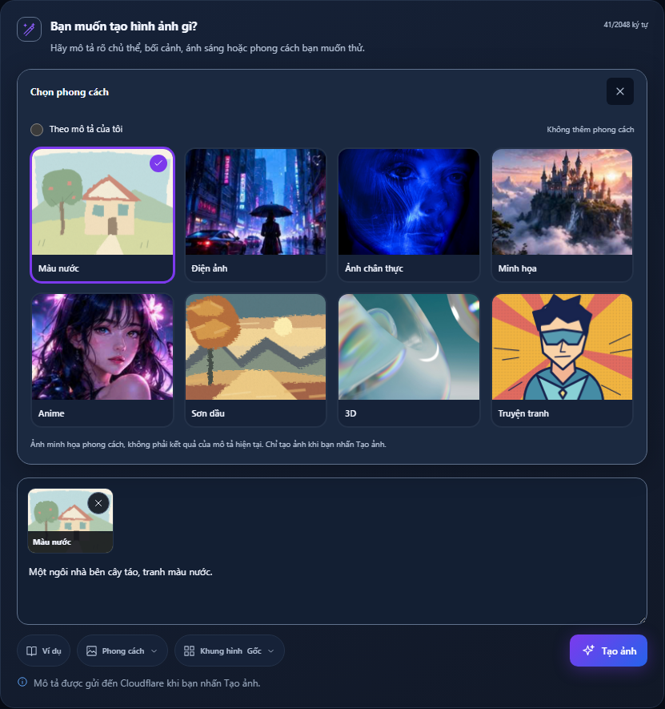
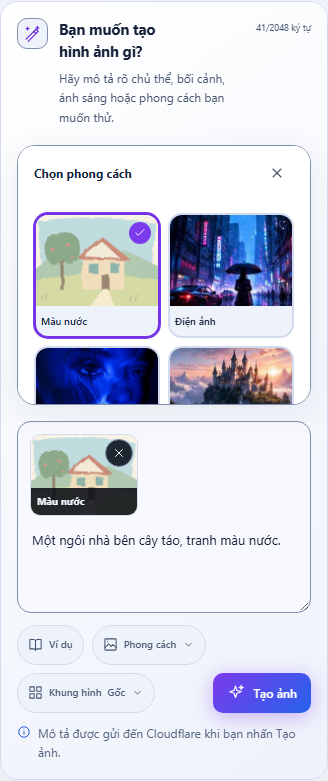
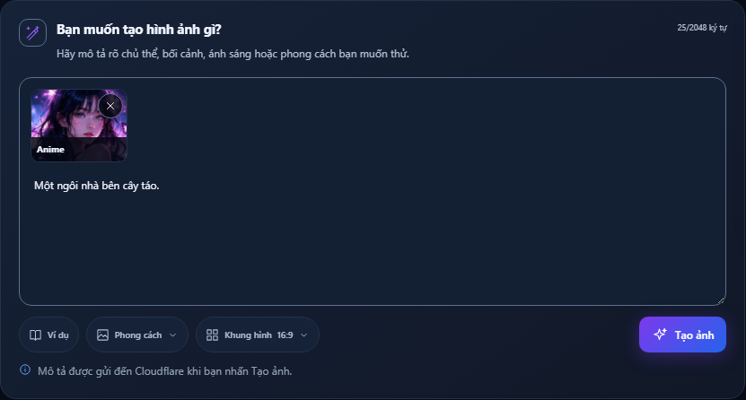
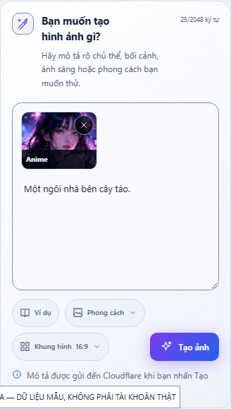
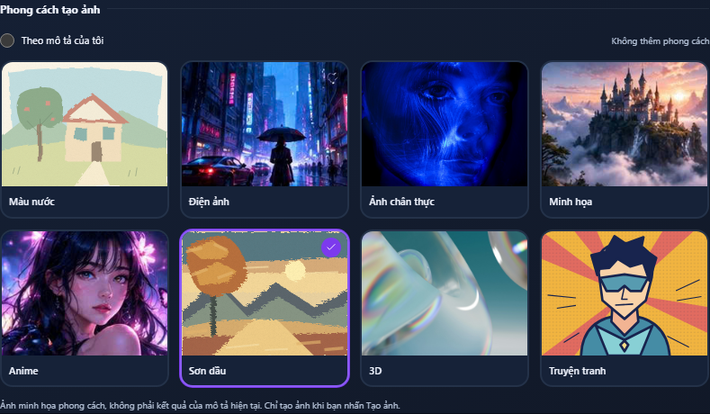
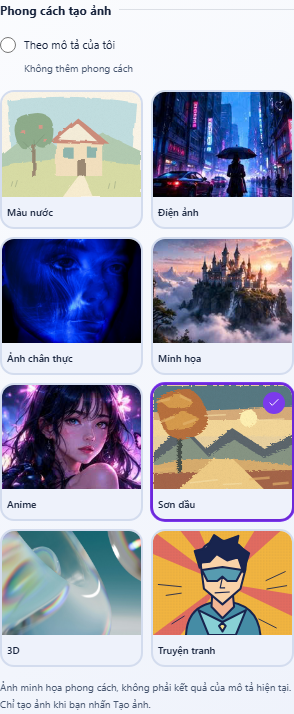

# Bộ chọn phong cách có ảnh minh họa — 07/11/2026

## Điểm bàn giao để tiếp tục — 08/11/2026

Theo yêu cầu chủ dự án, commit/push bản đang làm lên nhánh riêng
`codex/style-preview-cards` để tiếp tục buổi sau; chưa tạo PR hoặc merge develop.

- Giao diện bộ chọn phong cách/khung hình, ô nhập 2 dòng, chuyển động/hover,
  tự căn viewport và tự đóng sau lựa chọn đã được kiểm tra local như bên dưới.
- Backend ba preset Sơn dầu/3D/Truyện tranh hiện có whitelist và tiền tố prompt
  cơ bản trong `presentation.ts`; unit test và một luồng nhận/lưu/khôi phục job
  3D dùng API thật + MongoDB tạm đã đạt. Đây không phải xác nhận chất lượng ảnh thật.
- Buổi tiếp theo: tiếp tục rà soát/hoàn thiện backend cho cả ba preset và tiêu chí
  nghiệm thu, kiểm tra giữ nội dung prompt/giới hạn/idempotency; kiểm chứng hình
  ảnh thật trên môi trường được phép nếu cần, không gọi cloud thật trong test.
- Bộ E2E tổng quát vẫn chưa được ghi nhận đạt trọn bộ, xem giới hạn bên dưới.

Không đánh dấu ba phong cách đã nghiệm thu đầy đủ hoặc tick checklist issue vì lần push này.

## Cập nhật 08/11 — bộ chọn Khung hình đồng bộ (CONFIRMED)

Theo yêu cầu tiếp theo, Khung hình Gốc dùng 6 thẻ tỷ lệ, 3 cột × 2 hàng trong
bảng rộng bằng ô nhập, thay danh sách dọc hẹp. Preview khung giữ đúng tỷ lệ,
zoom 8% khi hover/focus-visible, tắt zoom theo reduced-motion; khung thẻ không
dịch bố cục. Dùng chung cơ chế tự căn vùng soạn, giới hạn chiều cao/cuộn riêng,
giữ input/CTA trong viewport. Chọn tỷ lệ (kể cả Gốc/chọn lại) tự đóng bảng và
cập nhật nhãn nút, Enter/Escape trả focus. Không đổi enum/payload hoặc xử lý
padding giữ toàn bộ ảnh đã chốt; không thêm cloud call, dependency hoặc token.

Kiểm tra: frontend build/diff check đạt. Browser QA synthetic có nhãn sáng/tối
tại 360×640, 768×800, 1280×720, 1536×900, 1920×900: đủ 6 tỷ lệ trong grid 3×2,
bảng rộng bằng input, không đè input/overflow và CTA trong viewport ngay cả khi
đã có chip phong cách. Chọn từng tỷ lệ/Gốc tự đóng, prompt được giữ, focus trở
về trigger; mũi tên/Enter/Escape hoạt động, hover zoom đạt, reduced-motion tắt zoom.
Đã xem ảnh desktop/mobile. Không chạy lại backend/DB/cloud cho thay đổi trình bày này.

## Cập nhật 08/11 — hover zoom và tự căn vùng soạn (CONFIRMED)

Theo yêu cầu mới nhất: ảnh zoom thêm 4% khi hover bằng chuột/focus-visible, dùng
CSS scale riêng để không ghi đè transform của pan/zoom đang chạy; thẻ/tên/vùng
bấm không thay kích thước. Hover zoom không áp dụng khi reduced-motion bật.

Khi mở bảng, focus radio dùng preventScroll, sau đó đo vùng soạn/topbar/viewport
để chừa chỗ cho ô nhập và toolbar, giới hạn max-height bảng và tự căn vùng soạn
dưới topbar nếu cần. Chỉ danh sách ảnh cuộn khi thiếu chỗ. ResizeObserver và
window/visualViewport resize cập nhật chiều cao; cleanup observer/listener/RAF
khi đóng. Màn hình điện thoại thấp ẩn phần mô tả phụ dưới tiêu đề trong lúc bảng
mở để chừa chỗ cho input/CTA; tiêu đề và nội dung người dùng vẫn giữ nguyên.
Smooth scroll ở chế độ thường, không smooth khi reduced-motion bật.
Không sửa payload/backend/token/asset hoặc thêm dependency.

Kiểm tra: frontend build/diff check đạt; browser QA sáng/tối tại 360×640,
768×800, 1280×720, 1536×900, 1920×900 đạt. Kiểm tra cả lần mở đầu và mở lại
với chip đã chọn: vùng soạn nằm dưới topbar, toolbar/CTA trong viewport, bảng
không đè input và không overflow ngang. Computed scale tăng khi hover, pan/zoom
vẫn chạy; reduced-motion tắt cả hiệu ứng, lựa chọn tự đóng và giữ prompt.
Đã xem ảnh viewport desktop, dữ liệu QA synthetic có nhãn; chưa thử bàn phím
ảo trên thiết bị thật, không dùng các kiểm tra này để xác nhận cloud/E2E tổng thể.

## Cập nhật 08/11 — 2 dòng, chuyển động rõ hơn, tự đóng (CONFIRMED)

Theo yêu cầu mới nhất: textarea 2 dòng, khoảng 64px desktop/72px mobile, vẫn
resize dọc và không cắt prompt. Bấm chọn phong cách, chọn lại cùng phong cách
hoặc `none` tự đóng bảng, trả focus về nút Phong cách và cập nhật/loại chip.
Radio phím mũi tên vẫn dùng được, Enter/Escape xác nhận/đóng bảng.

Hiệu ứng cũ chỉ đổi scale 3.5–6.5% trong 12–15 giây và dừng khi hover/focus,
nên khó nhận thấy. Chuyển sang pan ±2% ngang/±1.2% dọc, scale 1.12–1.20,
chu kỳ 6–8 giây; bỏ dừng khi hover/focus thẻ. Khung/tên/vùng bấm vẫn cố định,
ảnh được clip trong khung. Chip đang nhập liệu và fieldset disabled vẫn dừng;
prefers-reduced-motion vẫn tắt hiệu ứng. Không đổi asset, backend, token hay dependency.

Các phần dưới ghi lại các giai đoạn trước; quy tắc 2 dòng/tự đóng ở đây thay thế
các quyết định 3 dòng/giữ bảng mở hoặc dừng hover cũ.

Kiểm tra 08/11: frontend build và diff check đạt; browser QA sáng/tối tại
360/768/1280/1536px đạt. Textarea đo 64px desktop/72px mobile, rows=2.
So sánh transform trước/sau 650ms xác nhận chuyển động, animationPlayState
vẫn running khi hover; emulate reduced-motion tắt animation. Chọn mới/chọn lại/
none tự đóng và trả focus, prompt được giữ nguyên, không overflow, một CTA,
0 POST khi chọn/gõ, 0 page errors. Browser QA mặc định báo reduced-motion=false;
không suy ra thiết lập Windows của người dùng. Không chạy lại BE/cloud vì chỉ sửa UI.

## Tinh chỉnh mới nhất — ô nhập gọn và ảnh chuyển động (CONFIRMED)

Theo yêu cầu tiếp theo, textarea mặc định 3 dòng (khoảng 90px desktop/96px mobile),
vẫn cho resize dọc và cuộn nội dung dài. Giữ vùng ảnh phía trên, không đè input.
Ảnh minh họa và chip dùng một wrapper chuyển động phóng/dịch nhẹ 12–15 giây,
khác pha giữa các thẻ; crop gốc của ReferenceArtwork không bị ghi đè transform.
Khung, tên, dấu chọn và vùng bấm không chuyển động. Dừng ảnh khi hover/focus thẻ,
fieldset disabled hoặc chip trong input đang được focus; prefers-reduced-motion
tắt hiệu ứng. Chỉ CSS transform, không thêm dependency, ảnh/video, cloud call,
token hoặc thay đổi backend. Animation bị unmount khi đóng vùng chọn.

Kiểm tra: frontend build/diff check đạt; browser QA sáng/tối tại
360/768/1280/1536px đạt. Đo textarea 96px trên mobile và khoảng 89px trên desktop;
so sánh transform qua thời gian xác nhận ảnh tự chuyển động, focus thẻ dừng đúng,
emulate reduced-motion tắt animation. Rerun kiểm tra không overlap/overflow,
gõ khi vùng ảnh mở, giữ prompt, Escape/focus, tỷ lệ và 0 POST khi chọn/gõ đều đạt.
Ảnh minh chứng inline bên dưới được cập nhật theo kích thước ô nhập mới.

## Cập nhật mới nhất — ảnh phong cách không che khung nhập (CONFIRMED)

Theo phản hồi và ảnh mẫu mới của chủ dự án, chuyển vùng chọn ảnh ra phía trên
khung nhập trong luồng bố cục. Bỏ position absolute của bảng; bảng đẩy khung nhập
xuống thay vì che textarea. Desktop hiển thị đủ hai hàng; mobile giới hạn 260px
và cuộn riêng, giữ mở khi chọn phong cách hoặc focus/gõ trong khung nhập.
Nút Phong cách, nút đóng, Escape và click ra ngoài composer vẫn đóng vùng chọn.
Bảng tỷ lệ cũng nằm trong luồng phía trên input, chọn tỷ lệ vẫn đóng bảng.
Giữ thẻ ảnh đã chọn trong khung nhập, counter phía trên và một CTA Tạo ảnh.
Payload/backend/asset/token không đổi thêm trong lần sửa bố cục này.

Kiểm tra lần sửa này: frontend build và diff check đạt; browser QA synthetic có
nhãn tại 360/768/1280/1536px × sáng/tối đạt. Bounding box xác nhận đáy bảng nằm
trước mép trên khung nhập; click/gõ được textarea khi bảng mở, chọn/đổi phong cách
không mất prompt và không đóng bảng, Escape trả focus, tỷ lệ vẫn hoạt động,
không tràn ngang và 0 POST khi chọn/gõ. Không chạy lại cloud/DB vì không đổi API.

## Giai đoạn trước — thanh công cụ trong khung soạn (CONFIRMED)

Yêu cầu tiếp theo của chủ dự án thay bộ chọn luôn hiển thị bằng bảng chọn mở từ
nút **Phong cách** cạnh **Ví dụ**, và đưa **Khung hình** ra cạnh đó. Chỉ một bảng
mở tại một thời điểm. Chọn bằng chuột đóng bảng và trả focus về nút mở; phím mũi
tên đổi radio, Enter/Escape đóng bảng, click/focus ra ngoài cũng đóng. Tiêu đề/nút
đóng được giữ cố định khi cuộn bảng trên điện thoại.

Phong cách đã chọn hiện thành thẻ ảnh trong khung nhập, có nút bỏ chọn; không chèn
vào văn bản prompt. Bộ đếm lên góc trên; CTA Tạo ảnh chuyển vào cuối thanh công cụ,
chỉ còn một CTA. Panel phải giữ thông tin model/lượt dùng, không lặp bộ chọn/nút tạo.

Kiểm tra cho cập nhật này: frontend build đạt; browser 360/768/1280/1536px × sáng/tối
đạt về mở/đóng bảng, radio bằng bàn phím, Escape/focus, chip/bỏ chip, prompt không
bị sửa, counter nằm trên toolbar, một CTA và không overflow ngang. Đã xem ảnh
desktop/mobile. API thật + DB replica set tạm: chọn cả 8 phong cách không tạo POST;
gửi 3D + 16:9 qua CTA, MongoDB giữ style/ratio và prompt gốc, reload giữ chip/tỷ lệ,
nút chọn bị khóa khi queued. Một POST chủ động, 0 provider calls, 0 page errors.
Lần đầu MongoDB tạm không kịp khởi động trong 10 giây; tăng launch timeout của
script QA tạm lên 60 giây và chạy lại đạt. Không đổi cấu hình DB ứng dụng.

Backend không sửa thêm trong cập nhật UI này; kiểm tra backend ở phần dưới thuộc
giai đoạn bổ sung ba preset trong cùng task. Bộ E2E tổng quát chưa được ghi nhận
đạt trọn bộ; các assertion control được cập nhật để mở bảng và kiểm tra chip/nút khóa.

## CONFIRMED

Theo yêu cầu trực tiếp của chủ dự án, chuyển phong cách từ panel bên phải xuống dưới
ô mô tả và nút Ví dụ ở `/app/create`. Giữ 5 phong cách cũ, bổ sung **Sơn dầu, 3D,
Truyện tranh** theo lựa chọn của chủ dự án. Có 8 thẻ, desktop/tablet 4 cột × 2 hàng,
điện thoại dưới 600px dùng 2 cột × 4 hàng để giữ khả năng đọc/chạm. `none` vẫn là
radio riêng “Theo mô tả của tôi”, mặc định không thêm preset.

Thẻ dùng radio native, hỗ trợ phím mũi tên, focus, dấu check và border khi chọn.
Không POST khi chọn thẻ; chỉ CTA Tạo ảnh nhận job. Giữ nguyên khóa/khôi phục
presentation trong pending intent và job DTO. Backend whitelist thêm `oil-painting`,
`3d`, `comic`, thêm chỉ dẫn trước giới hạn 2048/quota qua luồng hiện có. Không đổi
model, auth, quota, migration hoặc dependency. Preset là chỉ dẫn, không bảo đảm ảnh bám 100%.

Ảnh thẻ là reference/demo có nhãn chung; nguồn và phân loại ở
[`assets/styles/README.md`](../../frontend/src/assets/styles/README.md).
Không gọi cloud để tạo asset. SVG là minh họa vector gốc; các asset đã có được tái sử dụng.

## Nguồn áp dụng

- Issue #1; yêu cầu trực tiếp trong phiên này là ngoại lệ được chốt cho bộ chọn 8 phong cách.
- AGENTS.md, PRD.md, writing-block.md, contract FE/BE và backend rules.
- Frontend-design/backend-api/backend-testing; design principles, color tokens,
  implemented UI reference, image workflow, layout/responsive, accessibility và motion/icon rules.

## Kiểm tra thực tế

- Frontend `npm run build`: đạt (TypeScript + Vite), chạy lại sau CSS cuối.
- Backend `npm run build`: đạt; `npm test`: 51 đạt, 1 skip do thiếu MongoDB test URI.
- `node --import tsx --test tests/integration/product.test.ts`: 1 integration scenario đạt,
  MongoDB replica set tạm và provider/storage giả lập; không dùng DB chung.
- Browser QA synthetic có nhãn ở 360/768/1280/1536px × sáng/tối: 8 ảnh tải được,
  đúng số hàng/cột, không overflow ngang, chọn một thẻ, bỏ preset về `none`,
  đổi bằng phím mũi tên và 0 POST khi chỉ chọn. Đã xem ảnh desktop/mobile.
- Kiểm tra browser riêng với API thật + DB tạm + worker không chạy: chọn cả 8 thẻ,
  gửi một job `3d`, xác nhận MongoDB giữ `settings.style`, prompt gốc và submittedPrompt
  có chỉ dẫn 3D; reload khôi phục lựa chọn, thẻ bị khóa khi queued; 1 POST chủ động,
  0 inference/provider calls, 0 page errors. Script QA tạm dùng hạ tầng của browser
  test hiện có, không đọc credential cloud.
- `git diff --check`: đạt.

## Giới hạn

Chưa nghiệm thu ảnh cloud thật cho ba preset mới. Browser QA về bố cục/luồng sử dụng
fallback artwork tĩnh (WebGL tắt), không kiểm thử motion vì không sửa phần này.
Full `tests/browser/library-history.ts` chưa đạt trọn bộ: selector avatar cũ gặp
strict-mode vì menu mới có hai avatar; đã thu hẹp locator vào trigger. Lần chạy lại
vẫn timeout ở phần tài khoản/điều hướng, không coi toàn bộ E2E đạt. Các assertion
phong cách được cập nhật cho radio; luồng thay đổi này đã được kiểm tra riêng như trên.

Không commit/push/merge hoặc sửa checklist issue trong task này. Phạm vi chỉ gồm
bộ chọn/phong cách, contract, asset và kiểm tra liên quan; không sửa token hay writing-block.md.

## Minh chứng (dữ liệu QA, không phải FLUX live)

